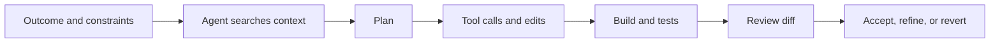

# Module 02 - Agent Workflows

> **Time:** 40 minutes
> **Goal:** Choose the right local Copilot workflow, supervise tool use, and delegate isolated work to custom agents or subagents.

This module focuses on local editor workflows. The GitHub-hosted cloud agent is covered in [Module 09](../09-cloud-agent/README.md).

## Choose the interaction level

| Need | Best starting point |
|---|---|
| Explain code or compare options | Ask/chat |
| Explore an approach before implementation | Plan mode |
| Implement a small or multi-file change | Agent mode |
| Reuse a specialist role | Custom agent |
| Isolate an independent investigation | Subagent |
| Delegate work to GitHub | Cloud agent in Module 09 |

## Agent loop

## Supervision practices

- Give acceptance criteria and validation commands.
- Review tool permissions before approval.
- Keep the working tree understandable.
- Ask the agent to explain assumptions.
- Run focused tests during iteration.
- Use a second review agent for risky changes.
- Stop and re-scope when the agent repeatedly edits the same area without progress.

## Guides

- [Local agent workflow](docs/local-agent-workflows.md)
- [Subagents](docs/sub-agents.md)
- [Selection guide](docs/agent-selection-guide.md)
