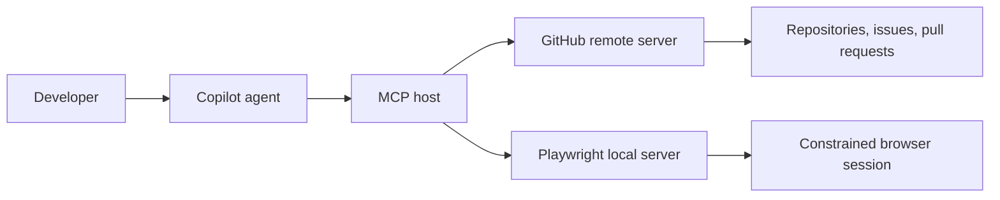

# Module 03 - MCP Servers

> **Time:** 35 minutes
> **Goal:** Connect Copilot to external tools through the Model Context Protocol while keeping permissions and data exposure deliberate.

MCP separates the agent host from tool providers. A server advertises tools, and the user or policy controls whether the agent can call them.



## Included samples

| Server | Transport | Best workshop use |
|---|---|---|
| [GitHub MCP server](github-remote-mcp/README.md) | Remote HTTP | Search repositories and work with issues or pull requests |
| [Playwright MCP](playwright-mcp/README.md) | Local stdio | Inspect and interact with the Node.js or testing demo |

The repository-level [`.vscode/mcp.json`](../.vscode/mcp.json) combines both examples. Authentication is not stored in the repository.

## Configuration

```json
{
  "servers": {
    "github": {
      "type": "http",
      "url": "https://api.githubcopilot.com/mcp/"
    },
    "playwright": {
      "command": "npx",
      "args": ["-y", "@playwright/mcp@latest", "--browser", "msedge"]
    }
  }
}
```

## Security checklist

- Install or connect only to servers you trust.
- Review the advertised tools before enabling them.
- Use least-privilege authentication and repository scope.
- Do not commit tokens, authorization headers, or captured data.
- Restrict browser targets and filesystem access during demos.
- Confirm destructive or write-capable tool calls before execution.
- Prefer a small approved server set over an unrestricted marketplace.

Use the current [GitHub MCP documentation](https://docs.github.com/en/copilot/customizing-copilot/extending-copilot-chat-with-mcp) and VS Code MCP documentation for the product version used in the workshop.
