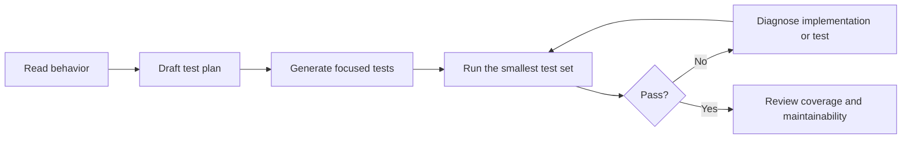

# Module 06 - QA and Testing

> **Time:** 40 minutes
> **Goal:** Use Copilot to plan tests, generate focused cases, run them, and review failures instead of accepting generated tests blindly.

## Samples

| Sample | Purpose | Run |
|---|---|---|
| [`csharp-unit-tests/`](csharp-unit-tests/) | Buildable xUnit and Moq example | `dotnet test` |
| [`playwright-samples/`](playwright-samples/) | Neutral UI with functional and accessibility tests | `npm install && npx playwright install chromium && npm test` |

## Workflow



## Demo prompts

```text
Create a test plan for WorkItemService before writing tests. Include happy paths, validation, cancellation, and persistence failures.
```

```text
Generate only the missing tests, run them, and explain any behavior assumptions.
```

```text
Use Playwright MCP to inspect the work item page and generate stable accessibility-first locators.
```

## Guides

- [Testing strategies](docs/testing-strategies.md)
- [Test-plan generation](docs/test-plan-generation.md)
- [Playwright and MCP](docs/playwright-ui-testing.md)
