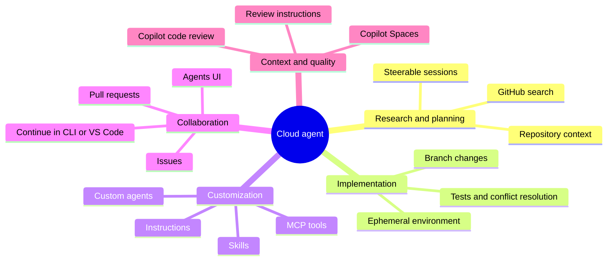

# Module 09 - Cloud Agent

> **Time:** 45 minutes
> **Goal:** Use GitHub's cloud-hosted Copilot agent to research, plan, implement, validate, and prepare repository changes for review.

**Cloud agent** is the current name for the feature formerly called **Copilot coding agent**.

The cloud agent runs asynchronously in an ephemeral GitHub Actions-powered environment. It can research a repository, create a plan, edit a branch, run validation, resolve conflicts, and create a pull request when the workflow calls for one.

## How work starts

| Entry point | Default outcome |
|---|---|
| Start from the Agents or Copilot interface | Works on a branch; you can steer it and choose **Create pull request** |
| Assign an issue to Copilot | Creates a pull request |
| Explicitly request a pull request | Creates one when the task completes |
| Mention `@copilot` in an existing pull request | Requests changes in that pull request |
| Use `/delegate` in Copilot CLI | Sends the task to the cloud agent and returns a draft pull request |

The old claim that every cloud-agent task automatically opens a pull request is no longer accurate.

## GitHub.com feature set

## Current related features

- **Copilot Spaces is GA** for curated, shareable context from repositories, files, issues, pull requests, and instructions.
- **Copilot code review is GA** and produces non-blocking review comments that still require human judgment.
- Code review can read `AGENTS.md`, `REVIEW.md`, `CLAUDE.md`, `GEMINI.md`, instructions, and skills from the pull request head branch.
- Repository configuration can define a review workflow, firewall, and independent runner.
- Medium review effort, sending suggestions to the cloud agent, and some skills/MCP review integrations remain public preview.

## Safeguards to explain

- restricted credentials and branch access
- human review before merge
- delayed or controlled workflow execution
- firewall and network controls
- signed commits, logs, and security scanning
- repository and organization policy

## Guides

- [Cloud-agent workflow](docs/cloud-agent-workflow.md)
- [Copilot code review](docs/code-review.md)
- [Copilot Spaces](docs/copilot-spaces.md)

Official reference: [About Copilot cloud agent](https://docs.github.com/en/copilot/concepts/agents/cloud-agent/about-cloud-agent)
